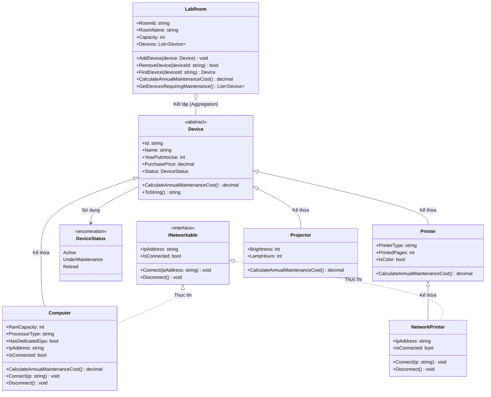
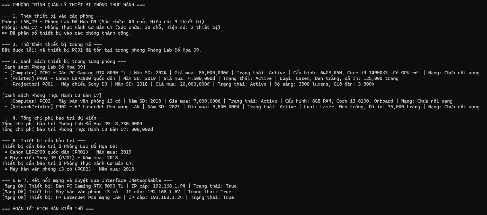

# Bài 5

Mã sinh viên: 202418989
Họ tên: Chu Đình Thi

## Link phiên làm việc AI
https://share.gemini.google/hR0Jmazgv2fI

## Phân tích và thiết kế

### A. Mô tả các class

#### 1. Class Device (Abstract)

- trách nhiệm: lưu mấy thông tin chung (mã, tên, năm, giá, trạng thái), làm khung cho lớp con.
- thuộc tính: `Id`, `Name`, `YearPutIntoUse`, `PurchasePrice`, `Status`.
- constructor: 1 hàm tạo gán thông tin cơ bản.
- phương thức: `CalculateAnnualMaintenanceCost()` (abstract), `ToString()`.
- quan hệ: lớp cha của Computer, Printer, Projector.

#### 2. Class Computer

- trách nhiệm: quản lý máy tính và tính tiền bảo trì, xử lý cắm mạng.
- thuộc tính: `RamCapacity`, `ProcessorType`, `HasDedicatedGpu`, `IpAddress`, `IsConnected`.
- constructor: hàm tạo nhận đủ thông số, gọi base.
- phương thức: override `CalculateAnnualMaintenanceCost()`, `Connect()`, `Disconnect()`.
- quan hệ: kế thừa `Device`, thực thi `INetworkable`.

#### 3. Class Printer

- trách nhiệm: quản lý máy in thường (cắm dây USB).
- thuộc tính: `PrinterType`, `PrintedPages`, `IsColor`.
- constructor: hàm tạo nhận đủ thông tin máy in.
- phương thức: override `CalculateAnnualMaintenanceCost()`, `ToString()`.
- quan hệ: kế thừa `Device`, làm lớp cha cho `NetworkPrinter`.

#### 4. Class NetworkPrinter

- trách nhiệm: quản lý máy in có cắm mạng LAN.
- thuộc tính: `IpAddress`, `IsConnected`.
- constructor: gọi constructor của `Printer`.
- phương thức: `Connect()`, `Disconnect()`.
- quan hệ: kế thừa `Printer`, thực thi `INetworkable`.

#### 5. Class Projector

- trách nhiệm: quản lý máy chiếu và tính tiền thay bóng đèn.
- thuộc tính: `Brightness`, `LampHours`.
- constructor: hàm tạo nhận thông số máy chiếu.
- phương thức: override `CalculateAnnualMaintenanceCost()`, `ToString()`.
- quan hệ: kế thừa `Device`.

#### 6. Interface INetworkable

- trách nhiệm: gom hành vi kết nối mạng.
- thuộc tính: `IpAddress`, `IsConnected`.
- phương thức: `Connect(ipAddress)`, `Disconnect()`.

#### 7. Class LabRoom

- trách nhiệm: quản lý danh sách máy trong phòng lab, tính tổng tiền.
- thuộc tính: `RoomId`, `RoomName`, `Capacity`, `Devices` (List chứa `Device`).
- constructor: nhận mã, tên, sức chứa.
- phương thức: `AddDevice()`, `RemoveDevice()`, `FindDevice()`, `CalculateAnnualMaintenanceCost()`, `GetDevicesRequiringMaintenance()`.
- quan hệ: kết tập vs `Device` (phòng chứa list thiết bị).

### B. Các bất biến của mô hình

- mã máy ko đc rỗng, chỉ gán lúc tạo.
- giá mua phải > 0.
- năm sử dụng ko đc lớn hơn năm nay.
- ko cho add trùng mã máy vào 1 phòng.
- đang nối mạng thì ko đc cắm lại, rút mạng thì IP thành null.

### C. Giải thích thiết kế nâng cao

- **Vì sao tách NetworkPrinter thay vì dùng Composition?**
  - Tách class kế thừa từ `Printer` dễ hiểu, code nhanh hơn vì máy in mạng bản chất vẫn là máy in.
  - Tận dụng lại hết thuộc tính của máy in mà ko phải viết thêm class adapter mạng lằng nhằng.
  - Bài lab nhỏ nên làm cách này cho gọn, đỡ overthinking.

- **LabRoom và Device là kết tập hay hợp thành?**
  - Là quan hệ **Kết tập (Aggregation)**.
  - Vì đề bảo máy chưa xếp vào phòng vẫn tồn tại đc trong hệ thống. Xóa phòng đi thì máy vẫn còn để chuyển sang phòng khác, ko bị hủy theo phòng.

- **Tính tiền bảo trì cả phòng bằng cách nào?**
  - Duyệt foreach qua list `Device` rồi gọi thẳng `d.CalculateAnnualMaintenanceCost()`.
  - Dùng đa hình để máy nào tự chạy công thức máy đó, ko cần viết if-else check từng loại máy.

### D. Sơ đồ thiết kế (Class diagram)

E.Ảnh chạy chương trình

